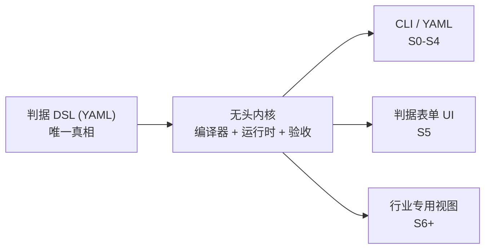
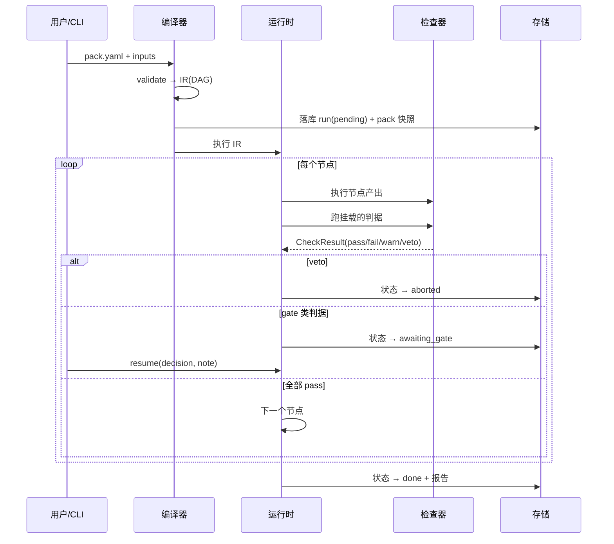

# 架构设计

## 1. 三分离：DSL / 内核 / 视图



三个约束：

| 约束 | 含义 | 违反后果 |
|---|---|---|
| DSL 是真相 | 数据库里存的是 YAML（或它的 IR），不是画布 JSON | UI 变成内核，换行业必须重写 |
| 内核无头 | 删掉所有视图，`hpx run` 仍能跑通全流程 | 无法做 CLI、无法 CI、无法自动化 |
| 视图可抛弃 | 每个视图都是内核的客户端，只依赖 IR 与 API | 每加一个行业就改一次内核 |

## 2. 必须现在定的五件事（与行业无关）

### 2.1 判据的类型系统

任何判据必须归入四类检查器之一。这不是行业问题，是元模型问题——行业只决定"填什么参数"。

| 类型 | 谁做判定 | 确定性 | 典型用途 |
|---|---|---|---|
| `rule` | 代码（采集 + 断言） | 完全确定、可复现 | 响度、条款编号、SLA 时长、字段完整性 |
| `schema` | JSON Schema | 完全确定 | 产物结构合法 |
| `judge` | 模型（绝对评分或成对比较） | 概率性，需多次取样 | 语气是否符合品牌、条款风险等级 |
| `gate` | 人 | 主观但可审计 | 合规放行、重大风险确认 |

**铁律**：`rule` 与 `schema` 必须能离线复现同一结果；`judge` 必须记录模型版本与温度；`gate` 必须记录审批人与理由。

### 2.2 中断点与状态

- 只有 `gate` 类型能产生中断。`judge` 不允许中断（它是评分，不是审批）。
- 状态机：`pending → running → awaiting_gate → running → done | failed | aborted`
- 所有状态变更写 `run_events` 追加表（事件溯源），当前状态是事件的投影。
- 断点恢复幂等：已完成节点不重跑，靠 `run_events` 判定。

### 2.3 产物契约的抽象

四种载荷类型，统一用"引用 + 摘要 + 校验入口"表示：

| kind | 格式 | diff 方式 | 典型行业 |
|---|---|---|---|
| `text` | Markdown / 条款树 JSON | 行级 + 结构级 | 法务、内容 |
| `timeline` | OTIO JSON | 剪辑点位移 | 视频 |
| `record` | JSON | 字段级 | 客服、工单 |
| `table` | CSV / Parquet | 行级 | 数据报表 |

内核只认 `artifact.kind` 与 `artifact.uri`，具体解析交给对应的 `loader` 插件。**不要在内核里写死 OTIO 或 PDF 的逻辑。**

### 2.4 版本与回滚

三层版本，互不干扰：

| 层 | 标识 | 变更频率 | 存储 |
|---|---|---|---|
| DSL 规范版本 | `dsl_version: "0.1"` | 极少（一年几次） | 代码常量 + 迁移脚本 |
| 判据包版本 | `metadata.version: 1.0.0`（语义化） | 每周 | 判据库，不可变快照 |
| 运行版本 | `run_id` | 每次 | 运行库，记录当时用的 pack 快照哈希 |

**判据包发布后不可修改**，只能创建新版本——这是可审计的前提。

### 2.5 租户与权限边界

第一天就按多租户设计，哪怕只有一个客户。

```
tenant_id 出现在每一张业务表的第一个字段，且是复合主键的一部分
```

权限三档（S5 才有 UI，但后端先有）：

| 角色 | 能做什么 |
|---|---|
| viewer | 看判据、看报告 |
| editor | 改判据草稿、试跑 |
| publisher | 发布判据版本、配置门禁 |

审计日志记录：谁、何时、改了哪条判据的哪个字段、旧值→新值。

## 3. 一次运行的完整生命周期



## 4. 存储模型（Postgres / SQLite 兼容）

```sql
-- 判据包（不可变快照）
criterion_packs(
  tenant_id, pack_id, version, dsl_yaml, ir_json,
  checksum, created_by, created_at,
  PRIMARY KEY (tenant_id, pack_id, version)
)

-- 运行实例
runs(
  tenant_id, run_id, pack_id, pack_version, pack_checksum,
  status, inputs_json, started_at, finished_at, triggered_by,
  PRIMARY KEY (tenant_id, run_id)
)

-- 事件溯源
run_events(
  tenant_id, run_id, seq, event_type, payload_json, created_at,
  PRIMARY KEY (tenant_id, run_id, seq)
)

-- 判据结果（宽表，便于统计）
check_results(
  tenant_id, run_id, step_id, criterion_id, checker_type,
  status, severity, message, evidence_json, duration_ms,
  model_version, created_at
)

-- 人工闸门
gate_decisions(
  tenant_id, run_id, criterion_id, approver, decision,
  note, decided_at
)

-- 黄金集
golden_cases(
  tenant_id, pack_id, case_id, inputs_json,
  expected_json, tags, created_at
)
```

索引建议：`check_results(tenant_id, criterion_id, status)` —— 这是"哪条判据最常失败"报表的基础，也是产品最有价值的数据。

## 5. 为什么不自研执行壳

| 组件 | 决策 | 理由 |
|---|---|---|
| agent 工具循环 / 沙箱 / 会话恢复 | **不自研** | 已商品化（DSH、Claude Agent SDK、OpenAI Agents SDK 均开源），自研是负收益 |
| 模型调用 | 走网关（LiteLLM 或 OpenAI 兼容层） | 换模型不改业务代码 |
| 工具接入 | **MCP** | 换壳时工具层不用重写 |
| 图编排 | 可先用现成（LangGraph），但 IR 必须自持 | IR 是你的资产，编排器可换 |
| 判据引擎、编译器、验收 | **自研** | 这是护城河，没人给你 |

关键：**IR（中间表示）是你自己的 JSON 格式**。它向下可以编译成 LangGraph 图、DSH 插件配置或纯 Python 函数链——所以编排器是可替换件。

## 6. 技术选型建议

| 层 | 建议 | 备注 |
|---|---|---|
| 语言 | Python 3.11+ | 判据引擎生态（Pydantic、ffprobe 绑定、OTIO、ASR）都在 Python |
| 模型层 | Pydantic v2 | schema 即代码，validator 复用 |
| CLI | Typer | 自动生成帮助文档 |
| 存储 | SQLite（本地）→ Postgres（S6） | 表结构一次设计好，只换驱动 |
| 图运行时 | 先用自写拓扑排序（S2），复杂后再接 LangGraph | 前期不值得引入重依赖 |
| 模型调用 | LiteLLM | 统一多厂商 |
| 观测 | OpenTelemetry → Langfuse | 埋点与厂商解耦 |
| 前端（S5） | Next.js + 复用一个 Python API 服务 | 或 HTMX 先跑通，避免过早 SPA |

## 7. 观测埋点最小集

每个 run 必须能回答：

1. 每个节点耗时、token 消耗
2. 每条判据的 pass/fail/error 分布
3. `judge` 类判据的模型版本与采样次数
4. `gate` 的平均等待时长、超时率
5. 整体通过率（按 pack 版本）

前四项是运维指标，第五项是**产品指标**——它直接对应"这个团队的 agent 是否变专业了"。
